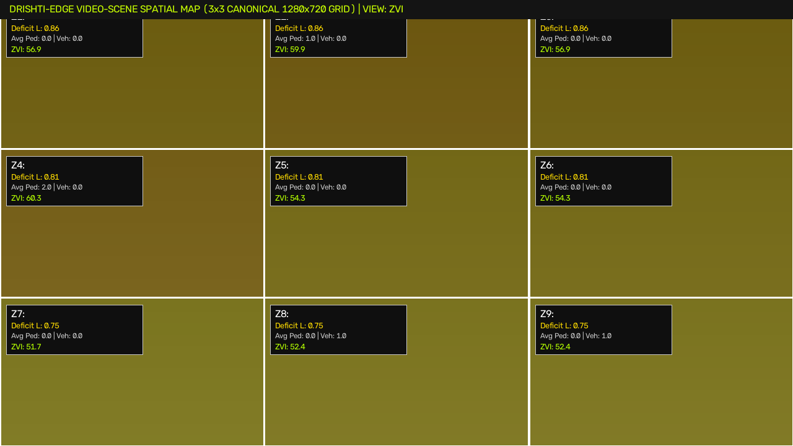
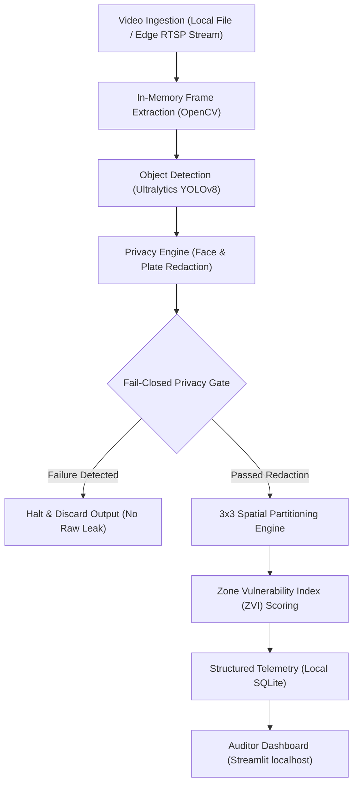

# Drishti-Edge (दृष्टि-Edge)

[](https://github.com/Kartik-idk/drishti-edge/actions)
[](https://www.python.org/)
[](https://opencv.org/)
[](https://streamlit.io/)

> A privacy-preserving, edge-native computer vision prototype for municipal safety auditing and video-scene hazard mapping.

Developed for the Seva First Innovation Challenge, **Drishti-Edge** explores how edge-native computer vision can deliver quantitative, repeatable public safety audits without streaming raw, identifiable street footage to cloud servers.

---

## Spatial Analysis Interface



*Figure: Automated 3×3 video spatial grid analysis computing Zone Vulnerability Index (ZVI) scores across pedestrian mobility, ambient illumination, and spatial congestion.*

---

## Problem Statement

Traditional urban safety auditing faces two contrasting extremes:
1. **Manual Field Inspections:** Infrequent, subjective, resource-intensive, and prone to severe sampling bias.
2. **Centralized Video Surveillance:** Streams high-resolution video of public spaces into centralized data repositories, creating massive privacy, surveillance, and data breach vulnerabilities.

**Drishti-Edge** resolves this tension by executing all computer-vision inference directly at the edge:
- **Transient Memory Processing:** Raw video frames are processed in volatile memory and immediately discarded.
- **Fail-Closed Privacy Gate:** Identifiable biometric features (faces) and vehicular markers (license plates) are redacted before any visual artifact or metric is saved.
- **Structured Metric Extraction:** Emits non-identifying spatial statistics and zone vulnerability indicators to local storage.

---

## System Architecture



### Key Engineering Decisions

- **Fail-Closed Privacy Design:** If any privacy detector or redaction step raises an exception or encounters missing configuration, the pipeline automatically aborts output generation with `FAIL_CLOSED` status rather than risking the leakage of unredacted footage.
- **3×3 Spatial Partitioning:** Rather than assigning single global hazard scores to entire scenes, frames are partitioned into a normalized 3×3 spatial grid (Top-Left through Bottom-Right), isolating localized hazards such as poorly illuminated sidewalks or blind alley corners.
- **Strictly Local Hosting:** The Streamlit auditing dashboard explicitly binds to `127.0.0.1`, preventing inadvertent network exposure of audit sessions.

---

## Zone Vulnerability Index (ZVI)

The audit engine computes a deterministic, multi-factor Zone Vulnerability Index (ZVI) scaled from 0 to 100 for each spatial zone:

$$\text{ZVI} = 100 \times (0.50 \cdot L + 0.35 \cdot I + 0.15 \cdot M)$$

Where:
- **$L$ (Lighting Deficiency):** Normalized luminance deficiency derived from grayscale pixel histogram analysis ($1.0 - \text{mean luminance}$).
- **$I$ (Infrastructure Risk Factor):** Presence of pedestrian-vehicle conflicts, narrow walkways, or visual occlusions.
- **$M$ (Mobility Exposure):** Density and movement velocity of pedestrian and vehicle bounding boxes detected within the spatial sector.

> **Honest Evidence Reporting:** If illumination or motion data is insufficient in a sector, the engine explicitly reports incomplete evidence (`EVIDENCE_MISSING`) instead of imputing artificial scores.

---

## Technology Stack

| Layer | Technologies |
| :--- | :--- |
| **Runtime & Language** | Python 3.10, 3.11 |
| **Computer Vision** | OpenCV (`opencv-python-headless`), Ultralytics YOLOv8 |
| **Spatial & Numerical Processing** | NumPy, Pandas, SciPy |
| **Storage & Persistence** | SQLite3, SQLAlchemy |
| **Auditor Interface** | Streamlit, Altair |
| **Testing & CI** | `unittest`, GitHub Actions (Ubuntu CI) |

---

## Local Setup & Quick Start

### Prerequisites

- Python 3.10 or 3.11 installed
- `ffmpeg` installed (for video codec support)

### Installation

1. **Clone repository:**
   ```bash
   git clone https://github.com/Kartik-idk/drishti-edge.git
   cd drishti-edge
   ```

2. **Create and activate virtual environment:**
   ```bash
   python3 -m venv .venv
   source .venv/bin/activate
   ```

3. **Install dependencies:**
   ```bash
   pip install --upgrade pip
   pip install -r requirements.txt
   ```

4. **Initialize configuration:**
   ```bash
   cp .env.example .env
   ```

5. **Run the auditor dashboard:**
   ```bash
   streamlit run app.py --server.address 127.0.0.1 --server.port 8501
   ```
   Open `http://127.0.0.1:8501` in your browser.

> Place permitted test video clips into `data/videos/`. Raw source videos are ignored by Git and will never be tracked or committed.

---

## Testing & Verification

Run the comprehensive unit and integration test suite:

```bash
python -m unittest discover tests
```

The test suite covers:
- Fail-closed privacy gate behavior and configuration error handling.
- Detector and redaction pipeline failure modes.
- 3×3 spatial zone calculation and ZVI index formulation.
- Streamlit audit mode workflows and synthetic video fixture handling.

---

## Research Boundaries & Limitations

- **Not Predictive Policing:** Drishti-Edge is an infrastructure and spatial auditing tool. It does not predict criminal activity, track individual identities, or perform biometric identification.
- **Comparative Indicator:** The Zone Vulnerability Index is a comparative heuristic intended to help municipal planners prioritize lighting and pedestrian infrastructure upgrades; it is not a formal safety certification.
- **Hardware Profile:** Tested on CPU and Apple Silicon edge environments; higher frame-rate throughput requires compatible edge accelerators (e.g., NVIDIA Jetson or Coral TPU).

---

## Documentation & References

- [Benchmark Reports](docs/benchmarks/)
- [Third-Party License Notices](THIRD_PARTY_LICENSES.md)
- [Environment Configuration Template](.env.example)
